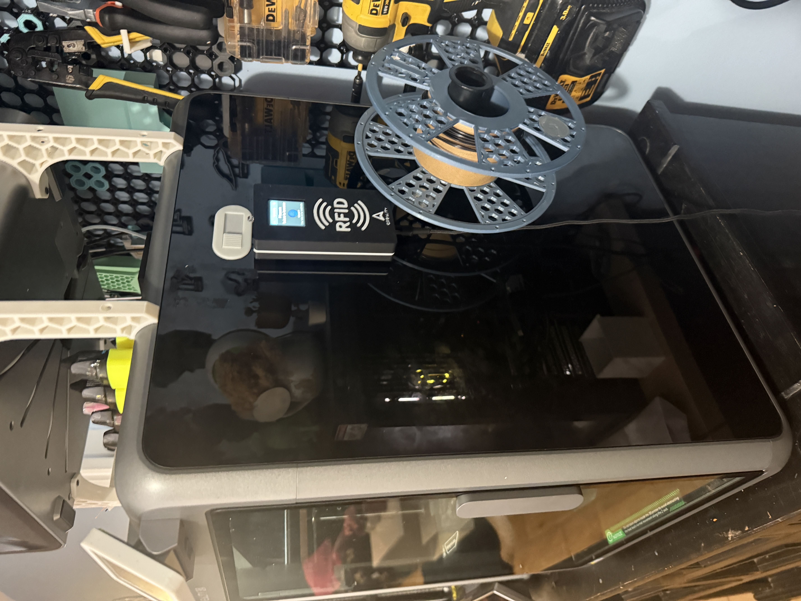
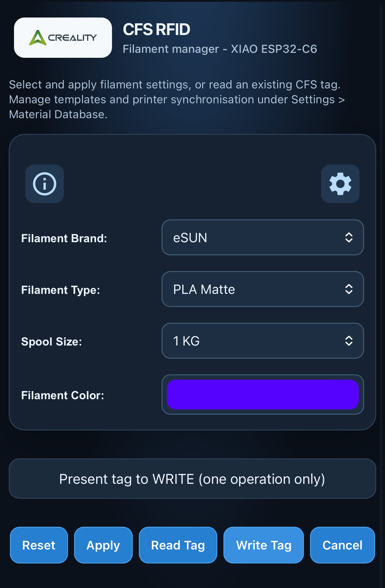
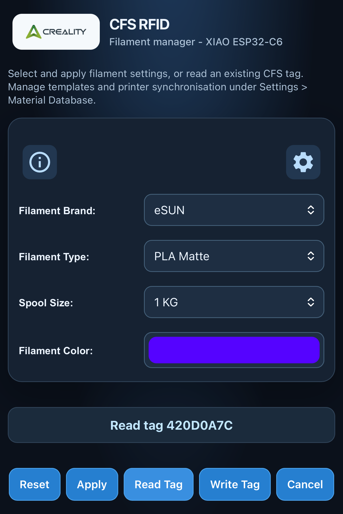
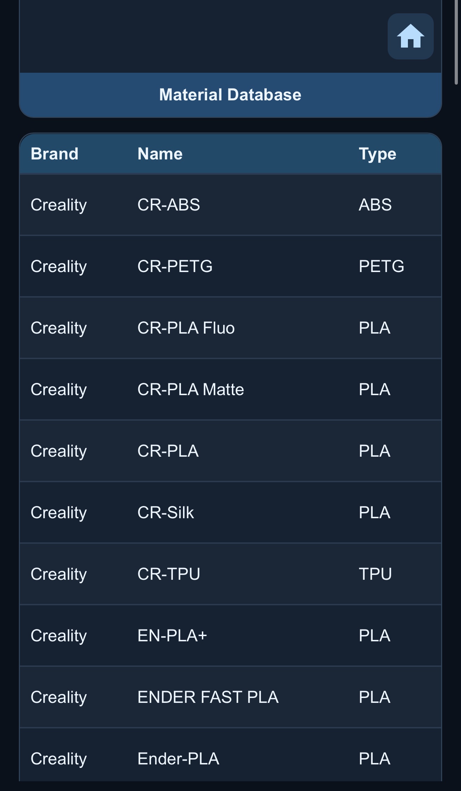
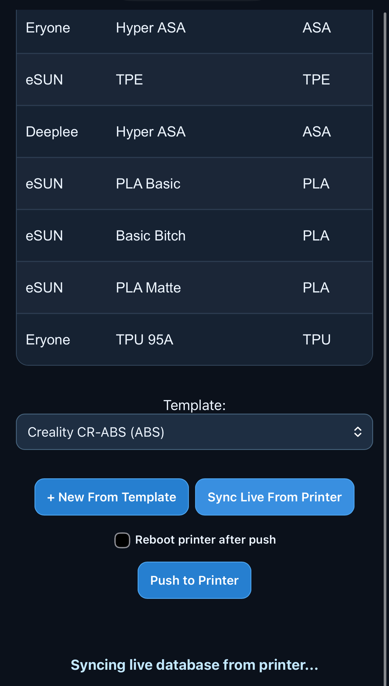
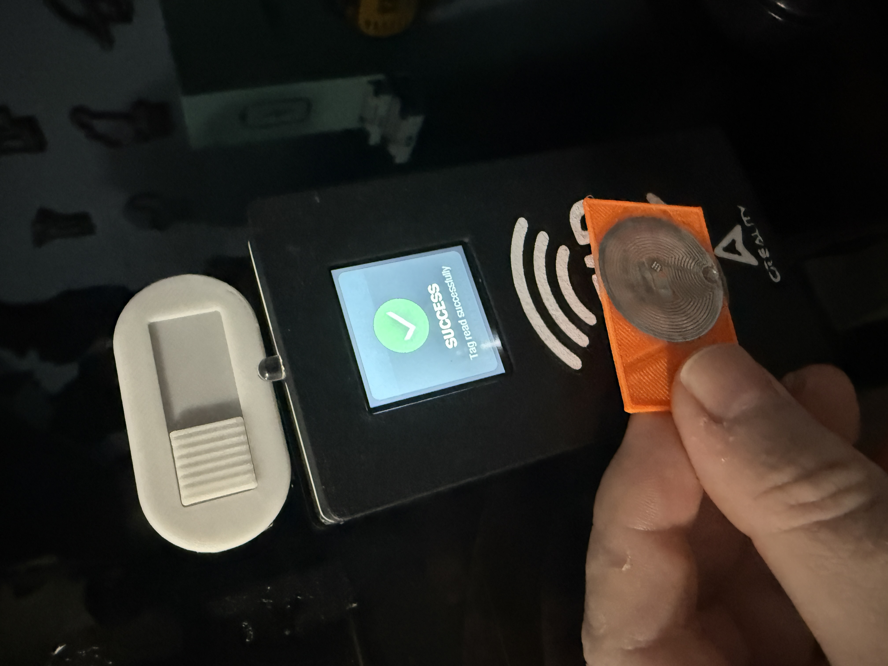
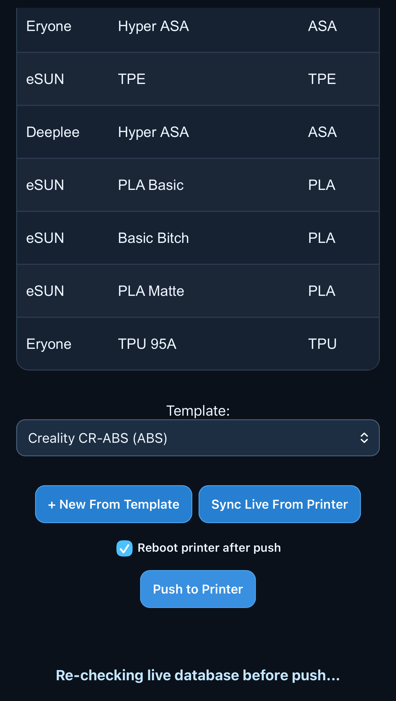
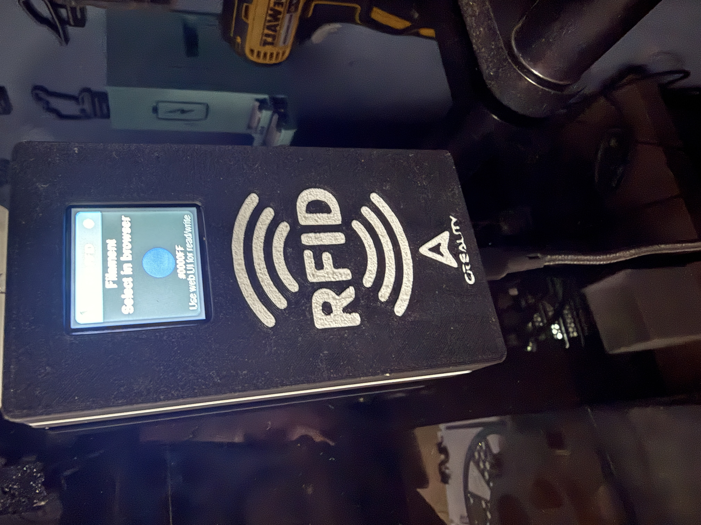

# CFS RFID — ESP32-C6 Reader & Writer

**Read and write Creality CFS-compatible filament RFID tags using a small, standalone device with a screen and web interface.** You can also manage filament entries and manually transfer material data to and from a compatible Creality printer.

Built around the **Seeed Studio XIAO ESP32-C6**, an **RC522 RFID reader**, and a **1.54-inch ST7789 colour display**.

> **Based on DnG-Crafts/K2-RFID:** This implementation adds the single-board XIAO ESP32-C6 arrangement, TFT interface, updated web UI and printer integration. The original Arduino project is credited to **[DnG-Crafts/K2-RFID](https://github.com/DnG-Crafts/K2-RFID)**.

> **Version 1.0.0 — feature-complete baseline.** Based on the locally tested v0.3.9 firmware, with no changes to RFID operations, printer transfer or database processing. The repository remains private while licensing, dependencies and a clean build of the sanitised source are reviewed. Enter your own configuration values before using it.

## What can it do?

- **Scan a tag:** Hold a compatible RFID tag near the reader to see its details on the display.
- **Read or write on demand:** Open the web page and choose the action you want. The device **does not write tags automatically**.
- **Choose filament details:** Select an existing filament or create a custom entry using the web interface.
- **See information on the screen:** The TFT shows material names, filament colours, tag status and confirmations.
- **Sync with a printer:** Use the web interface to manually download material information from your printer or send updated entries back to it.
- **Run from one board:** The reader, screen, web interface and printer connection all run on the XIAO ESP32-C6.

### A look at the web interface

| Main screen | Reading a tag |
| --- | --- |
|  |  |

You can also manage filament records and review printer transfers:

| Material database | Printer sync |
| --- | --- |
|  |  |

## What you'll need

- A **Seeed Studio XIAO ESP32-C6** microcontroller
- An **MFRC522 / RC522** RFID reader
- A **1.54-inch ST7789 240 × 240 SPI TFT** screen
- Suitable wires, a USB cable and a power source
- **MIFARE Classic 1K** RFID tags for CFS-compatible read/write testing
- A computer with **Arduino IDE** to upload the firmware
- A Wi-Fi connection for the web interface and optional compatible Creality printer connection

A buzzer and printable enclosure are also included in this build.

For the pin-by-pin connections, see the **[wiring reference (PDF)](docs/Wiring_Reference.pdf)** or the [editable Word version](docs/Wiring_Reference.docx).

## Quick installation

This is the short version for getting started. **Follow the [full installation guide](docs/INSTALL.md)** for library requirements, wiring and first-time setup.

1. **Assemble the hardware.** Connect the XIAO, RC522 and TFT using the [wiring reference](docs/Wiring_Reference.pdf). Check that your display module can safely power its backlight as wired.
2. **Install Arduino IDE and the ESP32 board package.** Install the external libraries listed in the [install guide](docs/INSTALL.md).
3. **Open the sketch:** `firmware/CFS_RFID_XIAO_C6_TFT/CFS_RFID_XIAO_C6_TFT.ino`.
4. **Enter your own settings.** Review the placeholder Wi-Fi, access point and printer settings in the sketch. Do not put private passwords into a public GitHub commit.
5. **Select the board and upload.** In Arduino IDE select **XIAO_ESP32C6**, **4 MB flash**, **USB CDC On Boot: Enabled**, and **No OTA (2MB APP / 2MB SPIFFS)**. Upload over USB.
6. **Connect and test.** Open Serial Monitor at **115200 baud**, connect to the device using its configured network settings, and open the web interface. Start with a **read test** on a known tag before attempting to write.

**Important:** If you're updating an already configured board, keep **Erase All Flash disabled** to avoid unnecessarily wiping stored settings. See the installation guide for LittleFS considerations.

## Reading and writing tags

1. Open the device's web interface.
2. For a **read**, select **Read Tag**, then hold a tag against the RC522 reader.
3. For a **write**, choose the filament details first, select **Write Tag**, then present a *spare/test* tag.
4. Check the confirmation on the TFT and in the browser.

Use an expendable tag when first learning the write process. Writing incorrect data may make a tag unsuitable for its intended use.

## Printer sync and push

The web interface also has separate actions to **sync/download material data from the printer** and **push/upload entries to the printer**.

**These are manual actions, not automatic background synchronisation.** Back up the printer's material database before your first push, and avoid testing database writes on a production printer until you understand the recovery process.

## 3D-printable enclosure

You can print the same case used for this build. The files are in **[enclosure_stls/](enclosure_stls/)**, including individual STL parts and a ready-to-print 3MF project.

### Which file is which?

| File | What it's for |
| --- | --- |
| [RFID with display - front.stl](enclosure_stls/RFID%20with%20display%20-%20front.stl) | Main front shell. Holds the screen and RFID reader. |
| [RFID with display - display secure.stl](enclosure_stls/RFID%20with%20display%20-%20display%20secure.stl) | Display retainer, which presses onto the locating pegs. |
| [RFID with display - back.stl](enclosure_stls/RFID%20with%20display%20-%20back.stl) | Back cover, where the XIAO ESP32-C6 is fitted. |
| [RFID with display - xiao secure.stl](enclosure_stls/RFID%20with%20display%20-%20xiao%20secure.stl) | Optional XIAO retainer, fixed with two M2 screws. |
| [RFID with display - text.stl](enclosure_stls/RFID%20with%20display%20-%20text.stl) | Separate face decoration / lettering for the front. |
| [RFID with display.3mf](enclosure_stls/RFID%20with%20display.3mf) | Pre-assembled print project with colours and print settings already configured. |

### Putting the case together

1. **Place the front shell face down** on a clean, flat surface so the inside is accessible.
2. **Fit the TFT display and RFID reader** into their positions inside the front shell.
3. **Secure the screen:** line up the *display secure* retainer with its pegs, then push it down to hold the display in place. Check that nothing is trapped or under strain.
4. **Install the XIAO ESP32-C6 into the back cover.** If it needs additional support, fit the optional *xiao secure* part with **two M2 screws** in the pre-made holes.
5. **Connect the electronics** according to the [wiring guide](docs/Wiring_Reference.pdf), carefully route the wires, then bring the front and back together.

**Adding the front logos:** The front STL does **not** include the RFID or Creality logos by default. To include them, import the front and the relevant separate logo/text pieces into **Creality Print** or **Orca Slicer**, align them and use the slicer's **Assemble** option to combine them into one print. Check alignment in the slicer preview before printing.

**Easiest way to print:** Open **[RFID with display.3mf](enclosure_stls/RFID%20with%20display.3mf)** to start with the pre-assembled model, colours and print settings. Review the printer profile, materials and plate settings before slicing for your own machine.

## Guides and reference

- **[Full installation guide](docs/INSTALL.md)** — software dependencies, Arduino settings and first tests
- **[Wiring reference](docs/Wiring_Reference.pdf)** — all board-to-board connections
- **[Security notes](docs/SECURITY.md)** — credentials, network access and safe printer testing
- **[Project origin and licensing](docs/UPSTREAM_AND_LICENSE.md)** — upstream credits and outstanding permissions
- **[Firmware change history](docs/history/)** — earlier development notes

## Credits and licence status

**Licensing is still under review.** The original upstream repository does not currently declare a repository licence, so please do not assume that the inherited code is available for unrestricted redistribution. Bundled library licences and the use of Creality branding must also be checked before a public release.

*This is a community hardware/firmware project, not an official Creality product.*
