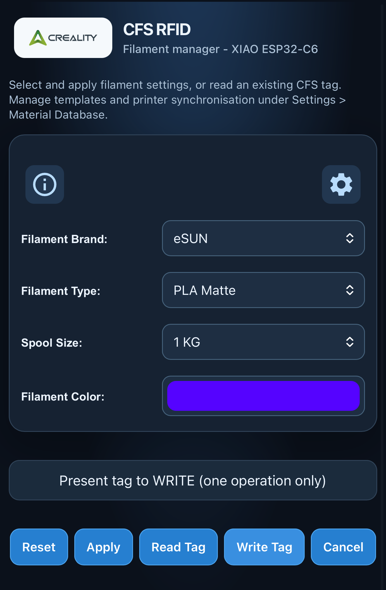
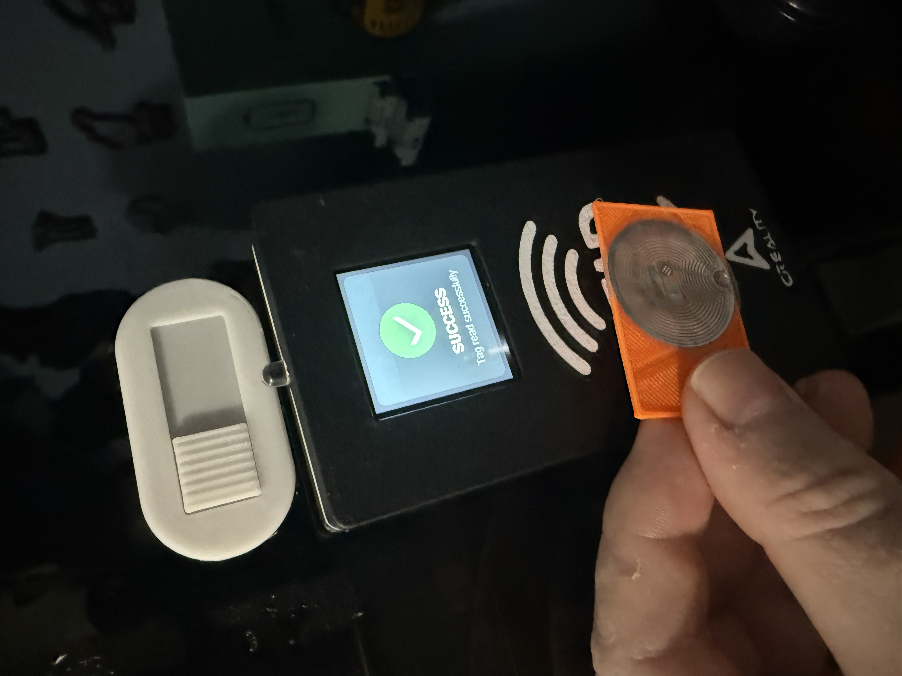
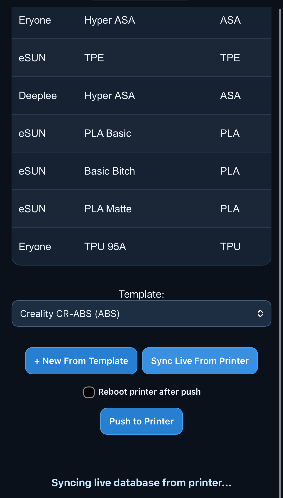

# Installation guide — CFS RFID ESP32-C6

This guide is for building and setting up the CFS RFID reader for the first time. You don't need to know how to program an ESP32, but you will need to **assemble and wire the electronics**, install some Arduino software, and upload the firmware by USB.

**Start here:** [Project overview and photos](../README.md) · [Wiring diagram (PDF)](Wiring_Reference.pdf) · [Printable enclosure](../enclosure_stls/) · [Security notes](SECURITY.md)

> **Before you start (v1.0.1):** This maintenance release builds on the v1.0.0 baseline, fixes the Database Updater interface, preserves manual JSON recovery and removes the obsolete web firmware updater. RFID operations and the established printer SSH/SCP/database transfer routines are unchanged. The public-safe source contains placeholder credentials; configure your own access-point and printer settings.

## 1. Collect the parts

| Part | Purpose |
| --- | --- |
| **Seeed Studio XIAO ESP32-C6** | Main controller for the reader, screen, web interface and printer connection |
| **MFRC522 / RC522 RFID module** | Reads and writes compatible RFID tags |
| **1.54-inch ST7789 SPI TFT, 240 × 240** | Colour status display |
| Jumper wires / suitable soldered connections | Connects the boards |
| USB data cable | Powers the XIAO and uploads firmware |
| **MIFARE Classic 1K RFID tag** | For initial read testing; have a spare for write testing |
| Optional buzzer, printed enclosure and fixings | Finishes the standalone reader |

The enclosure includes a front shell, back shell, screen retainer, optional XIAO retainer and a ready-to-print **3MF**. See [the enclosure instructions in the README](../README.md#3d-printable-enclosure).

### Connect the hardware

**Power off the XIAO before changing wiring.** The RC522 is a **3.3 V** device; do not connect its logic to 5 V. Both the RC522 and TFT share the SPI clock and data wires, but **each has its own chip-select pin**.

| XIAO ESP32-C6 | RC522 | ST7789 TFT | Notes |
| --- | --- | --- | --- |
| 3V3 | 3.3V | VCC (if your module supports 3.3 V) | Confirm your exact TFT module's supply requirements |
| GND | GND | GND | Common ground |
| D8 / GPIO19 | SCK | SCL / SCK | Shared SPI clock |
| D10 / GPIO18 | MOSI | SDA / DIN | Shared SPI data to peripherals |
| D9 / GPIO20 | MISO | — | RC522 data back to controller |
| D3 / GPIO21 | SDA / SS / CS | — | RC522 chip select |
| D2 / GPIO2 | RST | — | RC522 reset |
| D4 / GPIO22 | — | CS | TFT chip select |
| D5 / GPIO23 | — | DC | TFT data/command |
| D6 / GPIO16 | — | RST / RES | TFT reset |
| D1 / GPIO1 | — | — | Optional buzzer signal |

**TFT backlight (BL/BLK):** The tested build powered its backlight from 3V3, but the module's current-limiting arrangement has **not** been independently verified. Check your particular display board before copying that connection. See the [complete wiring reference](Wiring_Reference.pdf).

**Do not use GPIO3 or GPIO14** for other accessories in this build; these pins are reserved for the XIAO's antenna RF switch.

## 2. Install Arduino IDE

1. Download and install **[Arduino IDE](https://www.arduino.cc/en/software)** for your operating system.
2. In Arduino IDE, open **File → Preferences** (or the equivalent preferences menu).
3. In **Additional Boards Manager URLs**, ensure the Espressif ESP32 boards package index is configured using the official [Espressif Arduino-ESP32 instructions](https://docs.espressif.com/projects/arduino-esp32/en/latest/installing.html).
4. Open **Tools → Board → Boards Manager**, search for **esp32**, and install **esp32 by Espressif Systems**. The working project used an ESP32 Arduino core from the **3.3.x** series.
5. Connect the XIAO with a **USB data cable**, not a charge-only cable. Select the XIAO board under **Tools → Board**, then select the serial port under **Tools → Port**.

If you cannot see the board or port, try another data cable and check that the correct ESP32 package is installed.

## 3. Install the required libraries

In Arduino IDE open **Tools → Manage Libraries** (or **Sketch → Include Library → Manage Libraries**, depending on IDE version) and install:

- **Adafruit GFX Library**
- **Adafruit ST7735 and ST7789 Library**

The project also requires **libssh_esp32**, including its compatible **libssh** headers/dependencies, for its printer connection. This dependency is **not bundled** with the repository. Use a version compatible with your ESP32 Arduino core and the XIAO ESP32-C6. A precise tested release/source has not yet been pinned in this repository, so a fresh build may need dependency troubleshooting.

**Do not install a second copy of MFRC522 or AES over the project sources:** the sketch already includes those sources inside `firmware/CFS_RFID_XIAO_C6_TFT/src/`.

## 4. Open and configure the firmware

Open this file in Arduino IDE:

`firmware/CFS_RFID_XIAO_C6_TFT/CFS_RFID_XIAO_C6_TFT.ino`

The entire **`CFS_RFID_XIAO_C6_TFT` folder** must remain together; the sketch depends on local header files, web page source and other code under `src/`.

Near the start of the sketch you will find settings similar to:

```cpp
String AP_SSID = "CFS_RFID_Setup";
String AP_PASS = "CHANGE_ME_123";
String WIFI_SSID = "";
String WIFI_PASS = "";
String WIFI_HOSTNAME = "cfs-rfid";
String PRINTER_HOSTNAME = "";
bool AP_ENABLED = true;
```

What these mean:

- **AP_SSID / AP_PASS:** the Wi-Fi network and password that the device creates when access-point mode is enabled. **Choose a new, strong AP password before use.**
- **WIFI_SSID / WIFI_PASS:** your existing Wi-Fi name and password, if you want the device to join your network. They can initially be left blank while using setup AP mode.
- **WIFI_HOSTNAME:** the device's local network hostname.
- **PRINTER_HOSTNAME:** your compatible printer's address or hostname. Leave this empty until you're ready to configure printer functions.
- **AP_ENABLED:** enables or disables the device's own Wi-Fi access point. Keep it **true** for first-time setup so you have a way to reach the web page.

**OTA and printer credentials:** In this OTA branch, the printer root SSH password is configured through **Settings → Printer SSH Password** rather than compiled into the firmware. After the first OTA update from an older locally compiled build, enter your printer password in Settings and save; the reader restarts and stores it in `/config.ini`. Later OTA application updates should retain that value. Leave the field blank when saving settings to keep the previously stored password. The public GitHub Actions binary does not contain your credentials. **Do not publish passwords in commits, logs or screenshots.** The reader stores this password as plaintext in LittleFS and the local web settings form does not have authenticated HTTPS; use only on a trusted, isolated network.

> **Printer SSH password compatibility ([Issue #2](https://github.com/gavrd7/CFS-RFID-ESP32/issues/2)):** A contributor reported LibSSH-ESP32 authentication failures with a backslash (`\`) in the root password, even though their diagnostic reported the correct `0x5C` byte reaching the library. A separate K2 test successfully connected and pulled the material database with a trailing backslash, so this is **not a universal restriction**. When entering a password in the web Settings field, type the **literal password** normally; no C++ string escaping is required. If authentication fails, verify printer SSH access and saved settings. This applies only to printer SSH credentials, not Wi-Fi or AP passwords.

**Settings stored on the board can override the sketch's starting defaults.** When troubleshooting an existing device, check the web configuration and stored `/config.ini` values as well.

## 5. Choose Arduino upload settings

In **Tools**, choose the equivalent settings for your installed ESP32 core:

| Setting | Value |
| --- | --- |
| Board | **XIAO_ESP32C6** |
| USB CDC On Boot | **Enabled** |
| Flash size | **4 MB** |
| Partition scheme | **Custom `partitions.csv` from the sketch folder (two OTA app slots + LittleFS)** |
| PSRAM | **None** |
| Erase All Flash Before Sketch Upload | **Disabled** when updating a configured device |
| Serial Monitor baud | **115200** |

Other menu labels may vary with your ESP32 core version.

Click **Verify** (✓) to compile first. If successful, click **Upload**. Watch the IDE output for completion, then open **Serial Monitor** at **115200 baud**.

**Important for existing devices:** the sketch calls `LittleFS.begin(true)`, which means a LittleFS mount failure can result in formatting the filesystem. Do not assume `Erase All Flash: Disabled` guarantees stored configuration survives every failure or partition-layout change. Back up settings before reflashing or changing partition schemes.

### Moving an existing reader to web firmware updates

The **v1.0.1 release** and older builds were flashed using **No OTA (2MB APP / 2MB SPIFFS)**. That partition scheme cannot accept an OTA application update. This OTA development branch adds a custom `partitions.csv` for a **4 MB XIAO ESP32-C6**, with two 0x1B0000-byte application slots and a 0x90000-byte LittleFS-compatible data partition.

1. **Back up** your reader settings, Wi-Fi/AP configuration and material database before changing partitions. The old and new filesystem partitions differ and stored files may become inaccessible or be formatted.
2. Compile the **complete updated sketch folder**, including `partitions.csv`. Confirm the IDE/CLI build actually uses the custom partition table and that the application fits the OTA slot. Do **not** flash if the binary exceeds 0x1B0000 bytes.
3. **Flash once over USB**, with the correct 4 MB flash configuration, to install the new partition table and application. Restore configuration/data as necessary. Keep the USB recovery path available.
4. Once the new firmware runs successfully, open **Settings → Firmware Updater**, select the **CFS-RFID-XIAO-ESP32C6-OTA.bin** application image from a successful project release or GitHub Actions artifact, and choose **Update Firmware**. Check the result and wait for the reader to restart.

For subsequent web uploads, select **only the application OTA .bin**; never upload bootloader, partitions, merged-flash or arbitrary ESP32 binaries. Firmware uploads are **manual only**, and a web update cannot change the device's partition layout. A failed upload should keep the previously running firmware; the device will report errors rather than automatically restarting.

> **Security:** The device's web interface, including its firmware upload endpoint, is currently intended **only for a trusted local network** and has no verified authentication. Anyone who can access that endpoint may be able to install arbitrary firmware. Never expose it directly to the internet or an untrusted LAN. **OTA does not currently provide signed-firmware verification or guaranteed rollback.**

### Build assets from GitHub Actions

The `Build ESP32-C6 firmware and release assets` workflow compiles the sketch and packages the **OTA application binary**, a **versioned Arduino sketch ZIP** (including the custom partition table), the **wiring reference PDF**, **`enclosure_stls.zip`** (including the 3MF), and **SHA-256 checksums for every asset**. It takes the wiring and enclosure files from the same repository commit used to build the firmware, so releases automatically include revisions when those files change. Source code is also available from GitHub. Tagged `v*` releases attach these files when the build passes. The build is pinned to ESP32 core 3.3.3 and LibSSH-ESP32 5.10.0; it must pass CI and be hardware-tested before relying on release binaries. **If compilation fails or the binary is too large, no OTA binary should be published.**

The embedded web interface does not require a separate LittleFS filesystem upload.

## 6. Connect to the web interface

With the starting configuration above:

1. Power the XIAO and let it start.
2. On your phone or computer, look for the Wi-Fi network **`CFS_RFID_Setup`**.
3. Connect using the **AP password you configured** in the sketch. You may see a warning that this Wi-Fi network has no internet; that's normal for a standalone device.
4. In a browser, go to **[http://10.1.0.1](http://10.1.0.1)**.
5. You should see the CFS RFID web interface, where you can configure networking and use the reader.

If the device has already been connected to your home Wi-Fi, it may also be available via its configured local hostname (for example `http://cfs-rfid.local`) or its assigned local IP address. mDNS `.local` names depend on your device/network; if that address doesn't work, check the IP printed in the **Serial Monitor** or shown in your router.

**Do not disable the setup AP until you've confirmed you can reach the web interface on your usual network.** You can manage the network settings from the web interface once connected.



## 7. Test reading a tag (safe first test)

Do **reading first**, before testing writes or printer synchronisation.

1. Open the device's web interface and confirm it is responsive.
2. Present a known **MIFARE Classic 1K** tag close to the RC522 antenna. In passive mode, the display should show any information the firmware can recognise.
3. In the browser choose **Read Tag**, then present the tag again. Look for a read result or error message.
4. Remove the tag before trying another scan. The firmware is designed to avoid repeated operations on a continuously held tag.

The TFT may show the filament name, colour and UID when that information is available. Custom names depend on the display-name cache being populated.



### Test writing only after reading works

Use a **spare/disposable tag**, not one you depend on for a spool.

1. Select the intended filament/material and colour in the web UI.
2. Choose **Write Tag** explicitly.
3. Present the spare tag once and check the completion message.
4. Remove the tag and **read it back** to verify the expected details.

Writing is **not automatic** in passive mode. If the result is unexpected, stop rather than repeatedly attempting writes.

## 8. Printer integration (optional — do this last)

You do **not** need printer connectivity to get the reader, TFT and web interface working.

When ready, configure a compatible Creality printer's address and SSH access. This project has been developed around Creality printer material-database workflows; paths and permissions can differ by printer model or firmware.

The web interface provides these separate manual actions:

- **Database Updater → Select file / Update Database:** upload a local `material_database.json` to restore the reader’s material database. This remains available for recovery.
- **Database Updater → Sync From Printer:** retrieve the live material database directly from the configured printer using the existing SSH/SCP-backed sync function.
- **Material Database → Sync Live From Printer:** the same printer retrieval operation, also accessible where you edit materials.
- **Material Database → Push to Printer:** send edited material information back to the printer after reviewing changes.

**Back up your printer's material database before your first push.** A bad or incomplete transfer could damage printer configuration. Avoid experimenting with database writes on a production printer. The transfer and validation routines are intentionally kept unchanged from the tested firmware.



## 9. Common problems

| Problem | Things to check |
| --- | --- |
| Board or USB port isn't shown | Use a USB **data** cable, install the ESP32 board package, and select the correct port |
| Compile error for `Adafruit_GFX.h` or ST7789 | Install/update the corresponding Adafruit libraries |
| Compile error for `libssh_esp32.h` | Install a compatible `libssh_esp32` package and its dependencies; this is not bundled |
| TFT backlight on but screen blank | Recheck TFT CS/DC/RST pins and shared SPI wiring; verify the TFT's power/backlight requirements |
| RC522 won't read tags | Check 3.3 V supply, MISO/MOSI/SCK, RC522 CS and RST; try a supported tag |
| Can't find the setup Wi-Fi | Confirm `AP_ENABLED = true`, check the saved configuration and read the Serial Monitor |
| Can't open `10.1.0.1` | Connect **to the device's AP** first, check AP IP in Serial Monitor and use `http://` rather than `https://` |
| `.local` hostname not working | Use the device's local IP instead; mDNS discovery is network-dependent |
| Settings disappeared after reflashing | Review flash erase settings, partition changes and LittleFS mount/format messages |
| Printer sync/push fails | Verify network reachability, SSH access and printer compatibility; **do not keep retrying push without a database backup** |

## More information

- [README and project overview](../README.md)
- [Wiring reference PDF](Wiring_Reference.pdf) and [Word document](Wiring_Reference.docx)
- [Enclosure STLs and 3MF](../enclosure_stls/)
- [Security and safe publishing](SECURITY.md)
- [Original project, credits and licence review](UPSTREAM_AND_LICENSE.md)

**Credits:** This project builds on the Arduino code from [DnG-Crafts/K2-RFID](https://github.com/DnG-Crafts/K2-RFID). It is a community project, not an official Creality product.
